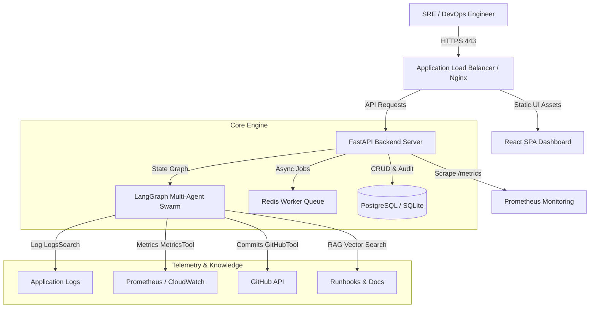
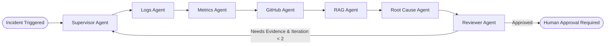

# 🚨 IncidentIQ — AI-Powered IT Incident Investigation & Response Platform

[](https://opensource.org/licenses/MIT)
[](https://www.python.org/)
[](https://fastapi.tiangolo.com/)
[](https://reactjs.org/)
[](https://python.langchain.com/docs/langgraph)
[](https://github.com/Vijaykumar5623/IncidentIQ.git)

> **IncidentIQ** accelerates production incident resolution by automatically retrieving operational evidence across logs, infrastructure metrics, Git deployments, and internal runbooks. Utilizing a **LangGraph Multi-Agent Swarm**, IncidentIQ identifies probable root causes, cites evidence, and recommends risk-rated remediations — requiring human authorization for high-risk operations.

---

## 🌟 Key Features & Capabilities

### ⚡ 1. Operational Data Simulator (Zero-Cost Laboratory)
- Synthesizes realistic production outage scenarios on demand:
  - 🛢️ **PostgreSQL Connection Pool Exhaustion** (Connection queue limit reached, unindexed queries).
  - 🧠 **Node.js Memory Leak** (Unclosed sessions, K8s `OOMKilled` exit code 137).
  - 🌐 **Third-Party API Gateway Timeout** (Stripe client read timeouts, HTTP 504 latency spikes).

### 🤖 2. LangGraph Multi-Agent Swarm System
- Directed Acyclic Graph (DAG) state workflow orchestrating specialized agents:
  - 👑 **Supervisor Agent**: Formulates a multi-step investigation plan.
  - 📜 **Logs Agent**: Deep dives into error logs & stack traces via `LogSearchTool`.
  - 📈 **Metrics Agent**: Evaluates CPU, RAM, latency & error-rate anomalies via `MetricsTool`.
  - 🐙 **GitHub Agent**: Analyzes recent deployment commits & code diffs via `GitHubTool`.
  - 📖 **RAG Agent**: Queries internal runbooks via `RAGSearchTool`.
  - 🔬 **Root Cause Agent**: Synthesizes telemetry signals into a grounded hypothesis.
  - 🛡️ **Reviewer Agent**: Validates evidence grounding, approving or triggering graph iterations.

### 📚 3. RAG Knowledge Base Engine (Runbook Retrieval)
- Ingests organizational runbooks, architecture docs, and past incident post-mortems.
- Semantic vector retrieval ranks and cites relevant runbook sections with confidence scores.

### 🛡️ 4. Human-in-the-Loop Approval & Remediation Execution
- **Consequential Safety Guardrail:** High-risk actions (**Service Restart**, **Config Patch**, **GitHub Pull Request**) *never* execute autonomously.
- Authorized SRE engineers inspect recommended remediations and click **Approve** or **Reject** in the UI.

### ⚡ 5. Redis Async Background Worker Queue
- Offloads long-running multi-agent investigations to background workers (`AsyncTaskQueue`).
- REST Endpoints support polling task progress (`POST /async-investigate`, `GET /tasks/{task_id}`).

### 📊 6. Self-Observability & AI Benchmark Suite
- **Prometheus Metrics (`/metrics`):** Exposes request counters, tool execution rates, and LLM latency histograms.
- **Empirical AI Benchmark (`evaluation/eval_runner.py`):** Runs automated test cases measuring **Root Cause Accuracy**, **Evidence Grounding Ratio**, and **MTTD**.

---

## 📐 System Architecture

### 🛠️ High-Level Enterprise Architecture



### 🔄 Multi-Agent Swarm Workflow DAG



---

## 📁 Repository Directory Structure

```text
IncidentIQ/
├── backend/
│   ├── app/
│   │   ├── agents/            # LLM Providers & LangGraph Swarm Nodes
│   │   │   ├── swarm/         # Supervisor, Logs, Metrics, GitHub, RAG, Reviewer
│   │   ├── api/v1/endpoints/  # Incidents, Simulator, Approvals, Tasks, Auth
│   │   ├── core/              # Database, Config, Security (JWT/RBAC), Metrics
│   │   ├── models/            # SQLAlchemy ORM Models (Incident, AuditEvent, Service)
│   │   ├── rag/               # Vector Document Chunker & Semantic Retriever
│   │   ├── remediation/       # Controlled Tools (GitHub PR, Pod Restart, Config Patch)
│   │   ├── simulator/         # Synthetic Outage Generators
│   │   ├── tools/             # Base Tool Calling Interfaces
│   │   └── workers/           # Redis Async Task Queue Manager
│   ├── tests/                 # 15 Pytest Integration & Unit Tests
│   ├── Dockerfile
│   └── requirements.txt
├── frontend/
│   ├── src/
│   │   ├── components/        # Dashboard, Incident Modal, Swarm Trace Visualizer
│   │   └── types/             # TypeScript Interfaces
│   ├── Dockerfile
│   └── nginx.conf
├── evaluation/
│   ├── dataset.json           # Ground-Truth Incident Benchmark Dataset
│   └── eval_runner.py         # AI Benchmark Evaluation Runner
├── infrastructure/
│   └── docker/prometheus/     # Prometheus Scraper Config
├── docs/
│   ├── PDR.md                 # Product Design Requirements
│   ├── BUILD_PLAN.md          # 18-Phase Implementation Tracker
│   └── ARCHITECTURE.md       # Enterprise AWS Cloud Blueprint
├── .github/workflows/ci.yml   # GitHub Actions CI/CD Pipeline
└── docker-compose.yml         # Multi-Container Compose Setup
```

---

## 🚀 Quickstart Guide

### Prerequisites
- **Python 3.10+**
- **Node.js 18+** & **npm**
- **Docker & Docker Compose** (Optional for containerized run)

---

### 💻 Option 1: Local Development (Python + Vite)

#### 1. Setup Backend
```bash
cd backend
python -m venv venv
# On Windows PowerShell:
.\venv\Scripts\Activate.ps1
# On Linux/macOS:
source venv/bin/activate

pip install -r requirements.txt
```

Start FastAPI Backend:
```bash
$env:PYTHONPATH="backend"; python -m uvicorn app.main:app --reload --port 8000
```
*API Swagger Documentation will be live at: [http://localhost:8000/docs](http://localhost:8000/docs)*

#### 2. Setup Frontend
```bash
cd frontend
npm install
npm run dev
```
*React Dashboard will be live at: [http://localhost:5173](http://localhost:5173)*

---

### 🐳 Option 2: Docker Compose (Full Stack)

To build and launch the complete stack (**Backend**, **Frontend**, **PostgreSQL**, **Redis**, **Prometheus**) in containers:

```bash
docker-compose up --build
```

Access Services:
- **Frontend App:** `http://localhost`
- **FastAPI API:** `http://localhost:8000`
- **Prometheus Metrics:** `http://localhost:9090`

---

## 🧪 Testing & Evaluation

### Run Backend Pytest Suite (15 Tests)
```bash
$env:PYTHONPATH="backend"; .\backend\venv\Scripts\python.exe -m pytest backend/tests
```

### Run AI Evaluation Benchmark
```bash
python evaluation/eval_runner.py
```

Sample Benchmark Output:
```text
=======================================================
📊 BENCHMARK EVALUATION RESULTS SUMMARY
=======================================================
Root Cause Diagnosis Accuracy : 100.0%
Evidence Grounding Ratio      : 100.0%
Tool Execution Success Rate   : 100.0%
Mean Investigation Time (MTTD): 0.02s
Benchmark Status              : PASSED
=======================================================
```

---

## 🔐 API Reference Summary

| Endpoint | Method | Description | Role Required |
| :--- | :--- | :--- | :--- |
| `/api/v1/incidents` | `GET` | List active production incidents | Public / User |
| `/api/v1/simulator/trigger` | `POST` | Trigger synthetic outage scenario | Admin / Operator |
| `/api/v1/incidents/{id}/investigate` | `POST` | Execute Single-Agent Investigation | User / Operator |
| `/api/v1/incidents/{id}/investigate-swarm` | `POST` | Execute LangGraph Multi-Agent Swarm | User / Operator |
| `/api/v1/incidents/{id}/approve-remediation` | `POST` | Authorize remediation execution | Operator / Admin |
| `/api/v1/incidents/{id}/async-investigate` | `POST` | Enqueue background async investigation | User / Operator |
| `/api/v1/tasks/{task_id}` | `GET` | Poll background async task status | User / Operator |
| `/api/v1/auth/login` | `POST` | Authenticate user & issue JWT token | Public |
| `/metrics` | `GET` | Prometheus operational metrics | Public / Monitoring |

---

## 📄 License & Attribution

Distributed under the **MIT License**. Created by [Vijaykumar5623](https://github.com/Vijaykumar5623).
