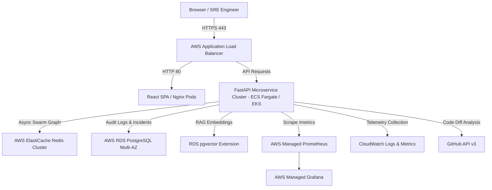

# IncidentIQ — Enterprise Cloud Architecture & Production Deployment Guide

## 1. System Overview

IncidentIQ is an AI-powered operational incident investigation and response platform designed to run in production environments across AWS, Azure, GCP, or hybrid Kubernetes (EKS/GKE).

---

## 2. AWS Production Architecture Blueprint

---

## 3. Core Component Architecture

### 3.1 Orchestration & Compute Layer
- **Container Platform:** AWS ECS Fargate or Amazon EKS (Kubernetes).
- **Auto-Scaling Policy:** Target tracking scaling based on CPU (70%) and Memory (75%) utilization thresholds.
- **Worker Queues:** Redis-backed async task workers (`AsyncTaskQueue`) scale dynamically to execute LangGraph multi-agent DAGs without blocking web server requests.

### 3.2 Database & Knowledge Base Layer
- **Relational Data:** AWS RDS PostgreSQL (Multi-AZ deployment for 99.99% availability).
- **Vector Search RAG:** `pgvector` extension hosted within RDS for zero-latency HNSW vector index lookups over organizational runbooks and post-mortems.

### 3.3 Security & Zero-Trust Model
- **Secrets Management:** AWS Secrets Manager for GitHub access tokens, database credentials, and JWT signing keys.
- **Authentication:** OAuth2 with JWT tokens and granular Role-Based Access Control (`USER`, `OPERATOR`, `ADMIN`).
- **Human-in-the-Loop Guardrail:** High-risk actions (`ServiceRestartTool`, `ConfigPatchTool`, `GitHubPullRequestTool`) require explicit `OPERATOR` / `ADMIN` authorization.

---

## 4. Disaster Recovery & Reliability SLA
- **RPO (Recovery Point Objective):** < 1 minute (PostgreSQL WAL streaming replication).
- **RTO (Recovery Time Objective):** < 5 minutes (Automated ECS task replacement and ALB health checks).
